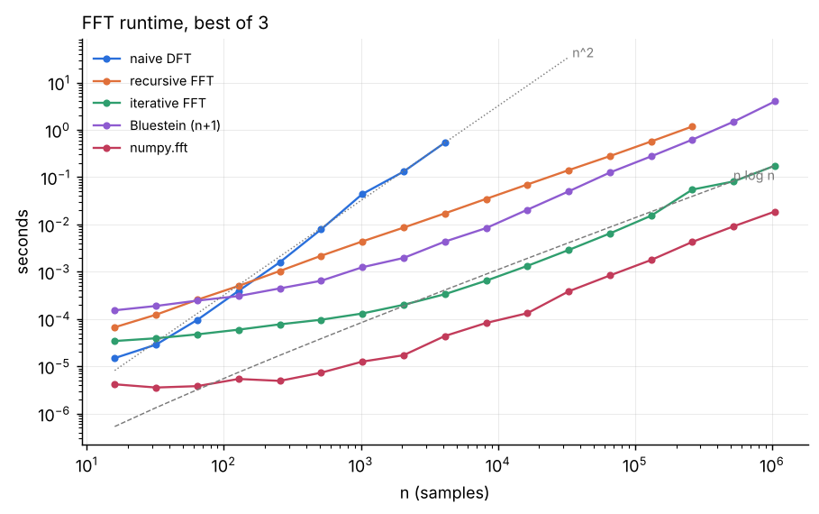
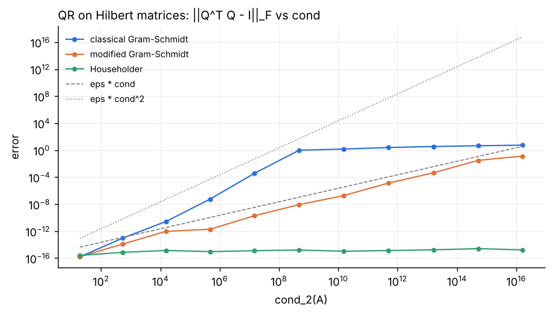

# Chapter 11 Technical Report FFTAnalyzer

## Executive summary

This project builds a small numerical computing toolkit around one algorithm, the Cooley-Tukey Fast Fourier Transform, written from scratch along with everything it needs underneath it and everything that gets built on top of it. Underneath sits the dense linear algebra (classical and Strassen multiplication, LU with partial pivoting, three versions of QR, and the power method, inverse iteration and unshifted QR iteration for eigenvalues) plus a stability module for measuring floating-point error and conditioning. On top sit 1D filters and spectral analysis, 2D image filtering, JPEG-style DCT compression, and three applications that clean up audio, filter and compress images, and find seasonality in time series. The iterative FFT handles 2^20 points in about 0.17 seconds, matching numpy to about 1e-16 relative error, and 290 tests check everything against numpy and LAPACK.

## Numerical algorithm theory

The FFT rests on one identity. The length-n DFT of x splits into the DFT of its even samples plus a twiddle factor times the DFT of its odd samples, X[k] = E[k] + w^k O[k] and X[k + n/2] = E[k] − w^k O[k]. Two half-size problems plus O(n) combining gives T(n) = 2T(n/2) + O(n), which is O(n log n). I implemented it twice. The recursive version is that recurrence written literally. The iterative version uses the fact that the recursion always ends up reading the input in bit-reversed order, so it does that permutation once and then runs log2(n) passes of butterflies, each pass vectorized across every block at once. Arbitrary lengths go through Bluestein's algorithm, which rewrites any DFT as a convolution and evaluates that convolution with power-of-two FFTs, and the DCT uses Makhoul's reordering so that a length-n DCT costs one length-n FFT.

On the linear algebra side, LU with partial pivoting keeps every multiplier at or below 1 in magnitude, and that bound is what makes Gaussian elimination stable in practice. Householder QR is orthogonal to working precision regardless of the input. Gram-Schmidt builds Q by subtraction, and how much orthogonality it loses depends on the order in which it subtracts.

## FFT and spectral analysis

The signal layer is the FFT put to work. Filters multiply the spectrum by a zero-phase response, with an optional raised-cosine transition to tame the Gibbs ringing a brick wall produces. FIR filters are designed by windowing a sinc and applied by FFT convolution. On a 101-tap, 100 Hz low-pass at 1 kHz the worst stop-band leakage beyond 160 Hz was −37 dB with a rectangular window, −61 dB with Hamming and −83 dB with Blackman, the ordering the theory predicts. Spectral estimates are scaled so that integrating the PSD returns the signal's power, and the tests check that identity (Parseval) directly. Welch averaging cut the periodogram's coefficient of variation by more than four times on white noise, and pink noise generated by shaping white noise in the frequency domain came out with a log-log slope of −0.99 against a target of −1. Parabolic interpolation finds a tone's frequency to within 0.05 Hz with 1 Hz bins, and autocorrelation is computed as the inverse FFT of the power spectrum (Wiener-Khinchin).

The time-series analyzer is where I made a mistake worth recording. My first version took the period from the autocorrelation peak, and it reported 343 for a true 365-day cycle and 24 for a true 21-day cycle hidden in simulated stock returns. With only two cycles, or heavy noise, the ACF peak is broad and its maximum drifts. The interpolated periodogram peak was within 3 percent in both cases, so the final version uses the spectrum to locate a period and the ACF only to confirm it, against a 99 percent white-noise threshold. It finds 7 and 356 in the synthetic sales data and 21 in the returns, and it confirmed nothing in 50 runs of pure white noise.

## Image and audio results

The audio demo builds a clip with a known clean signal (three harmonic notes) plus 60 Hz mains hum with two harmonics plus white noise, so every step can be scored. The noisy clip starts at 2.4 dB SNR. Notching the hum takes it to 13.1 dB, cutting 37 dB from the 60 Hz band. A 2 kHz low-pass takes it to 19.2 dB, and spectral subtraction on the STFT brings it to 21.6 dB. The spectral subtraction step first produced garbage. The inverse STFT divided by the summed window, which is nearly zero at the very first and last samples, and a single tiny divisor blew the output up to around 86. Padding by a full window before the transform fixed it.

For images, a Gaussian blur is just a multiplication by another Gaussian in the frequency domain, and it matches scipy's spatial filter to within 1e-3. Sobel and the Laplacian match scipy to round-off. On the synthetic test card with σ = 0.15 noise, a Butterworth low-pass at 0.25 cycles per pixel cut RMSE from 0.140 to 0.082. Lower cutoffs did worse than doing nothing, because the card's fine stripes sit above them. Periodic stripe noise shows up as two bright dots in the spectrum, and a notch filter on those dots cut RMSE from 0.176 to 0.040 without touching the rest of the image. The JPEG pipeline gave 27.4 dB at quality 5 (0.26 estimated bits per pixel), 34.5 dB at quality 30 and 47.8 dB at quality 90. The quality-30 coefficients saved as a compressed file are 11.6 times smaller than the raw image, with no Huffman stage at all. The reason JPEG uses the DCT rather than the DFT is easy to measure: on an 8×8 block of the card, the six largest DCT coefficients held 83 percent of the energy, against 61 percent for the DFT.

## Stability considerations

The stability module produced the bug that taught me the most. I computed the 2-norm condition number as the square root of the extreme eigenvalue ratio of AᵀA, and it reported 5.6e8 for the 8×8 Hilbert matrix, whose true value is 1.5e10. The cause is that cond(AᵀA) = cond(A)^2, which here is about 2e20, beyond 1/ε, so the factorization of AᵀA was pure noise. The fix runs inverse iteration on AᵀA without ever forming it, using two triangular solves with A's own LU per step, and it now agrees with numpy to 0.1 percent up to n = 10. It's the same trap as the normal equations in least squares.

The other results matched theory closely. On the Hilbert matrix of size 10 (cond 1.6e13), classical Gram-Schmidt lost orthogonality completely (‖QᵀQ − I‖ = 3.5), modified Gram-Schmidt reached 4.4e-4, roughly ε·cond, and Householder stayed at 1.7e-15. LU with pivoting on the same system left a residual of 1.2e-16 but a forward error of 7.7e-5. That is backward stability in one line: the solver did its job perfectly, and the conditioning of the problem still cost about twelve of the sixteen digits. Without pivoting, [[1e-20, 1], [1, 1]] x = [1, 2] returns x = [0, 1] instead of [1, 1]. All five catastrophic-cancellation examples (the quadratic formula, 1 − cos x, eˣ − 1, one-pass variance, long summation) show the naive formula losing between 1e-10 and 100 percent relative accuracy while the rewritten one is exact to double precision.

## Benchmarking plots

All figures are in `benchmarks/results/`, produced by `benchmarks/benchmark_fft.py`.

At n = 4096 the iterative FFT is about 1,600 times faster than the O(n^2) DFT. The recursive version is about 22 times slower than the iterative one at 2^18, entirely because of its 2n − 1 Python calls. Numpy's FFT is still about 9 times faster than mine at 2^20, since it does the same arithmetic in compiled code. Bluestein at length 2^20 + 1 took 4.0 seconds, 23 times slower than radix-2 at 2^20, because it must pad to 2^22, which is its worst case.

Classical Gram-Schmidt tracks ε·cond^2 until it saturates at O(1), modified Gram-Schmidt tracks ε·cond, and Householder stays flat.

Two results surprised me. FFT convolution only beat my direct convolution once the kernel reached 2048 taps, because the direct version loops over the kernel but vectorizes over the signal, so the real comparison is k numpy operations against three FFTs. And Strassen (0.137 s) beat the vectorized classical algorithm (0.195 s) at n = 512 but not below it, while numpy's BLAS beat both by a factor of 35 to 50.

## Final reflections

The engineering lesson from this project is that an algorithm's correctness and the problem's conditioning are separate questions, and tests only catch the first if their inputs are hard enough to expose the second. The AᵀA condition number bug, the drifting ACF periods and the ISTFT edge blow-up all passed my early tests on random, well-conditioned or noise-free data. Each one showed up only on a Hilbert matrix, a two-cycle series or the first sample of a clip. The FFT itself was the easy part. Making everything built on it give the right answer on awkward inputs was the real work.
