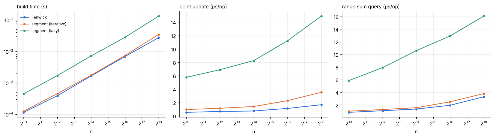
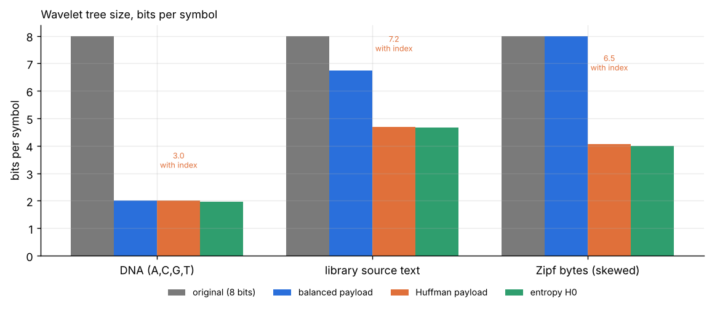
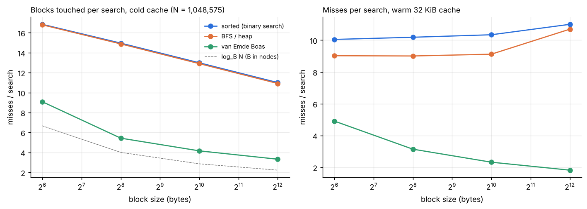

# Chapter 12 Technical Report: Advanced Data Structures

## Executive summary

This project builds `advds`, a library of advanced data structures written from scratch in Python, plus three applications and a benchmark suite. The library covers range-query trees (a segment tree with lazy propagation, Fenwick trees and a persistent segment tree), succinct structures (a bit vector with constant-time rank and select, and a wavelet tree), and cache-oblivious algorithms (recursive matrix transpose and multiplication, and the van Emde Boas tree layout). The applications are a range query engine with time travel, a small Git-like version control system, and a DNA index. 205 tests check them, mostly against brute force. The headline results: a persistent tree stored 5,001 versions in 3,034 times less space than separate copies; a DNA wavelet tree took 3.0 bits per base including its index; and the cache-oblivious algorithms reached the minimum possible number of cache misses without being told the cache size.

## Overview of advanced data structures

Balanced trees and hash tables answer one question: what is stored under this key? The structures in this chapter answer harder questions within the same O(log n) budget. Range trees answer questions about a whole interval. Persistent trees answer questions about any past version. Succinct structures answer rank and select while using barely more space than the raw bits. Cache-oblivious designs reduce data movement between memory levels, which often costs more than the arithmetic itself. They share a few techniques: precompute aggregates over a hierarchy of blocks, share instead of copy, and recurse until a subproblem fits.

## Tree-based range queries

A segment tree caches the sum, minimum and maximum of every node's interval, so any query combines at most about 4 log n nodes. A test confirms this count on 16,384 elements. Range updates use lazy propagation: a node that the update fully covers records a pending tag instead of visiting its subtree. The tag is pushed to the children only when a later operation needs to look inside. Combining range assignment with range add needs one rule: an assignment clears any pending add, and an add on top of a pending assignment changes the assigned value.

The Fenwick tree stores n + 1 words, and each slot holds a block whose length is the lowest set bit of its index. Prefix sums strip one bit per step and updates add one. A second version uses two Fenwick trees to support range add with range sum. At n = 262,144 a Fenwick query took 3.3 µs and an update 1.7 µs. The lazy segment tree took 16.1 µs and 14.9 µs: its extra generality costs about 5–9× in Python, and 20 words per element against the Fenwick tree's one.

## Persistent structures

The persistent segment tree never modifies a node after creating it. Each update copies the root-to-leaf path it changes, 17 nodes for n = 65,536 (log₂ n + 1), and points the copies at the unchanged subtrees. Each version is a root pointer; versions can branch from any earlier one, forming a DAG of shared nodes. Ordinary lazy tags would break this, because pushing a tag down modifies children that other versions share. Range add therefore uses permanent tags, which are never pushed down; queries add them up on the way down. Diffing two versions skips every shared subtree, so finding one change between consecutive versions took 31 µs.

The same idea, path copying, also drives a persistent hash trie, `PersistentMap`. Every node carries a Merkle hash, and a subtree holding a single key is stored as just that leaf. Because of this, the tree's shape depends only on its contents, and the tests confirm that the same keys inserted in any order produce the same root hash.

## Succinct & compressed structures

The bit vector packs 64 bits per word. Rank uses Jacobson's two-level directory: absolute counts per 512-bit superblock, relative counts per 64-bit block, and a 65,536-entry popcount table for the last partial word. That is three array reads and four table lookups whatever the length. Rank took 0.36 µs at 2¹² bits and 0.72 µs at 2²², likely memory effects rather than extra work. The naive popcount scan took 55 µs at only 2¹⁸ bits. Select uses samples taken every 512 ones (or zeros), then a binary search over the superblock counts, then a byte-level lookup table. That is constant time when the ones are spread out but O(log n) in the worst case, and I say so in the code rather than claiming true O(1). The index adds 50% on top of the bits. Exhaustive tests caught a real bug: `rank1(n)` returned the wrong count when n was a multiple of 64 but not of 512, because the lookup fell one word past the end.

The wavelet tree splits the alphabet at each node and stores one rank/select bit vector per node, which gives access, rank, select, range counting and range quantiles in O(log σ) time. A Huffman-shaped variant uses less space. On the library's own source text (σ = 98) it used 4.69 bits per symbol against an entropy of 4.67, while the balanced shape used 6.74. On skewed Zipf data the balanced shape used 8.0 bits and Huffman 4.06. Huffman shapes cannot answer quantiles, because the codes no longer follow value order.

## Cache-oblivious methods

An ideal-cache simulator (fully associative, LRU, 64-byte lines) replays every memory address each algorithm touches, because Python timings hide cache behaviour. Transposing a 1024 × 1024 matrix with a 32 KiB cache took 1,179,648 misses with the naive loop. The recursive version needed only the compulsory 262,144, the minimum needed to load every cache line once, without knowing the cache size. Traversing by column took 8× more misses than traversing by row, and the recursive traversal matched row order.

For matrix multiplication at n = 96, with an 8 KiB L1 and a 64 KiB L2, the naive ijk order missed 112,896 times at both levels. An 8 × 8 blocked version, tuned for L1, cut L1 misses to 28,800 but still had 16,128 at L2. The recursive version had 18,432 at L1 and 6,336 at L2, because a recursive algorithm works well at every cache level at once. With real numpy timings at n = 4096, the recursive transpose took 0.082 s against 0.309 s for the naive one.

The van Emde Boas layout stores a search tree as recursive half-height subtrees. On a million keys, a search touched 9.1 cache lines at 64-byte blocks, against 16.8 for binary search and BFS order. At 4 KiB blocks the counts were 3.3 against 11.0. That follows the log_B N curve for every block size.

## Applications (VCS, DNA, range queries)

**Range queries.** The engine sends sums to a Fenwick tree, minima and maxima to the lazy segment tree, and history to the persistent tree, with every update going to all three. It answers "what was the maximum at t = 15?", diffs two moments, and undoes changes.

**Version control.** File states are stored in the `PersistentMap`, with contents in a content-addressed blob store. Commits hash the tree, parents, author and message, as Git's do. Branches, three-way file-level merges and conflict detection all work. In a 5,000-file repository, diffing two commits that differ in one file visited only 49 trie nodes (a few tens of µs).

**DNA.** A wavelet tree over the bases answers "how many A's in [l, r]?" and "the k-th smallest base in a window". A second wavelet tree over the Burrows–Wheeler transform forms an FM-index. Its sampled suffix-array rows are marked in a rank/select bit vector. On a million bases, counting a pattern took 30 µs against 3,069 µs for scanning the string, and the index used 6.9 bits per base against 64 for a plain suffix array. The bundled sample is synthetic; `read_fasta` accepts real FASTA files.

## Benchmarks & analysis

All plots and tables are in `benchmark_results/`.

The lazy segment tree's query time grew 2.75× while n grew 256×. The theory predicts 1.8× (the ratio of the logarithms); the extra growth is likely memory effects. The persistent update cost 9.8 µs, slightly less than the ephemeral lazy tree's 11.6 µs. Path copying adds little: the lazy tree's push and pull steps cost more than the copies do.

The rank/select overhead dominates small wavelet nodes. DNA went from 2.0 bits per base for the bits alone to 3.0 with the index; real libraries shrink this with sparser samples.

## Final remarks

Two lessons stand out. First, the classic structures earn their reputations, but Python changes what wins. Constant factors decide most comparisons here: the Fenwick tree beat the segment tree at everything it can do. Cache effects were also invisible in pure-Python timings, which is why the cache experiments used a simulator. Second, exhaustive testing against brute force matters most at the boundaries. The rank bug appeared only at certain multiples of 64, and my DNA generator let planted motifs overwrite each other until a test caught it. Getting those edges right took more work than writing the structures.
